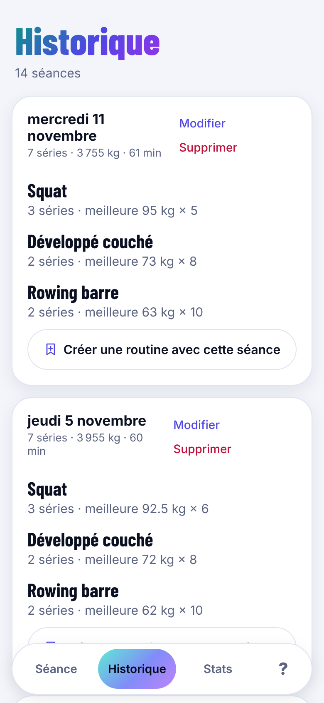

# Fluxe Suivi

### 👉 [Ouvrir l’application](https://ryoths.github.io/Fluxe-Suivi/)

> Sur cette page GitHub, cliquer sur `index.html` montre le code de l’application, pas l’application elle-même.
> Pour l’utiliser, touche le lien ci-dessus (ou ouvre https://ryoths.github.io/Fluxe-Suivi/ dans Safari).

Fluxe Suivi est un carnet de musculation pour le téléphone.
C'est une « application web installable » (PWA) : elle s'ouvre dans Safari puis s'ajoute à l'écran d'accueil comme
une vraie application. Une fois installée, elle fonctionne **sans connexion**.

Adresse : https://ryoths.github.io/Fluxe-Suivi/

| Accueil | Historique | Stats |
|---|---|---|
|  |  |  |

## Ce que fait l'application
- **Séance** : tu lances une séance vide ou une de tes **routines**. Tu notes tes séries (charge et répétitions ; durée, distance et calories pour le cardio), puis tu coches ce qui est fait.
- **Chrono de repos** : il démarre tout seul après chaque série et se règle pendant le repos. Une vibration discrète, sans son, signale la fin.
- **Routines** : elles se créent depuis une séance de l'Historique et se modifient en détail (séries, poids, reps, blocs cardio).
- **Historique** : toutes tes séances passées, modifiables. Les données, la sauvegarde et la corbeille sont aussi ici.
- **Stats** :
  - **Semaines d’affilée** et **récompenses** (24 médailles) ;
  - **Mon corps** : poids, courbe et mensurations ;
  - **Ma progression** : un mannequin de face et de dos qui se colore selon ta progression réelle (régularité et force), muscle par muscle ;
  - **courbes de progression** par exercice (charge max, 1RM estimé, volume) ou pour toutes les séances (volume, séries, durée) ;
  - volume par semaine, répartition par groupe musculaire ;
  - 3 records (poids max, meilleure série, volume).
- **Guide** (bouton `?`) : ta salle, ses machines (avec un dessin pour chacune) et tes notes de réglage.

## Où vont tes données
- **Sans compte** : tout reste **sur ton téléphone**, rien n'est envoyé sur Internet. Plusieurs protections existent : fichier de sauvegarde, versions de secours automatiques, corbeille de 30 jours.
- **Avec un compte « Sauvegarde en ligne »** (facultatif, gratuit) :
  - tes séances sont aussi sauvegardées en ligne (Google Firebase, serveurs en Europe) ;
  - tu les retrouves sur tous tes appareils ;
  - chacun ne voit que ses propres données.
  - Détails : [page Confidentialité](confidentialite.html).

## Installer sur iPhone
1. Ouvre l'adresse de l'application dans **Safari** (pas dans un autre navigateur).
2. Touche le bouton **Partager** (le carré avec une flèche vers le haut).
3. Choisis **Sur l'écran d'accueil**, puis **Ajouter**.
4. Lance Fluxe Suivi depuis sa nouvelle icône. Ouvre-la une fois avec du réseau : elle se garde alors en mémoire pour marcher hors ligne.

## Lancer les tests
Les tests automatiques vérifient que tout fonctionne avant qu'une mise à jour arrive sur le téléphone.
```
npm ci
npx playwright install chromium
npm test
```
Résultat attendu : tous les tests passent (`fail 0`). GitHub les relance tout seul à chaque proposition de modification.
Le détail est expliqué dans `tests/README.md`.

`npm run ranger` remet en forme le code de `js/` (outil Prettier, réglages dans `.prettierrc.json`) sans en changer le sens.

## Publier une nouvelle version
1. Garder une copie de la version en ligne : branche GitHub `sauvegarde-v…`.
2. Changer le numéro de version à **3 endroits** (les tests vérifient qu'ils correspondent) :
   - `js/config.js` : la valeur `VER='…'` ;
   - `index.html` : la balise `app-version`, le lien `css/app.css?v=…` et le lien `js/main.js?v=…` ;
   - `sw.js` : le nom du cache `VERSION` (par exemple `'v30'` devient `'v31'`) et les deux liens `?v=…` de la liste `FICHIERS`.
3. Ajouter une ligne en haut de `docs/VERSIONS.md`.
4. `npm test` doit être au vert (GitHub le refait), puis on fusionne dans `main`.

## Où trouver quoi
| Fichier ou dossier | Rôle |
|---|---|
| `index.html` | La page de l'application |
| `css/app.css` | Les styles (thème clair uniquement) |
| `js/` | Le code, découpé en petits fichiers par rôle (voir `js/README.md`) |
| `js/gestes/` | Ce que fait chaque bouton, rangé par thème |
| `js/vues/` | Un fichier par écran |
| `lib/` | Firebase (copie locale des fichiers officiels de Google) et le pont `nuage-firebase.js`, chargés seulement avec un compte |
| `firestore.rules` | Règles de sécurité de la base en ligne (chacun n'accède qu'à ses données) |
| `confidentialite.html` | Page Confidentialité (données gardées, droits, contact) |
| `sw.js` | Le « service worker » : garde une copie de l'app pour le hors ligne |
| `manifest.json` | Nom, couleurs, icônes et captures de l'application installée |
| `icons/`, `fonts/` | Icônes, image de démarrage et police Barlow Condensed (dans l'app, sans site extérieur) |
| `app.js` | Ancien fichier gardé pour réparer les vieilles pages déjà installées |
| `tests/` | Les tests automatiques (`01` à `24`, voir `tests/README.md`) |
| `.nojekyll` | Fichier vide : GitHub publie le site tel quel, sans le transformer |
| `screenshots/` | Captures d'écran (données de démonstration) |
| `docs/VERSIONS.md` | Historique des versions et copies de secours |
| `docs/STOCKAGE.md` | Tout ce que l'app range dans le téléphone (clés, base de secours, caches) |
| `docs/TEST-APPAREILS.md` | Liste à cocher pour tester une version sur le téléphone |
